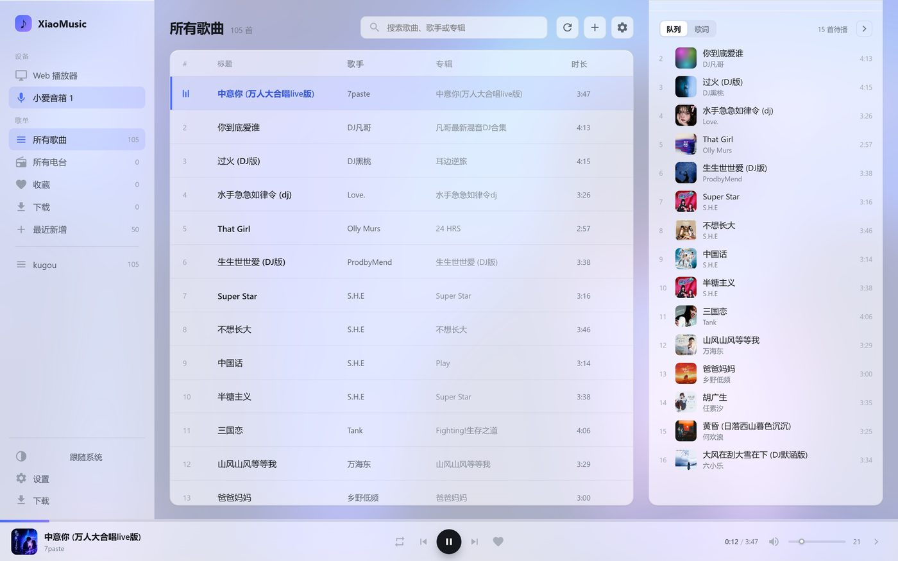
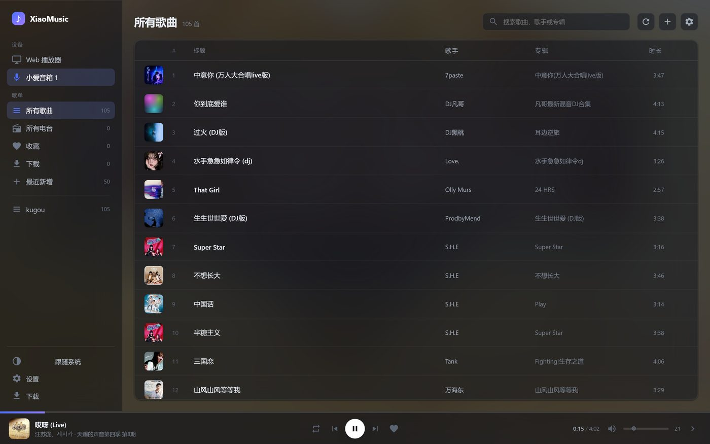
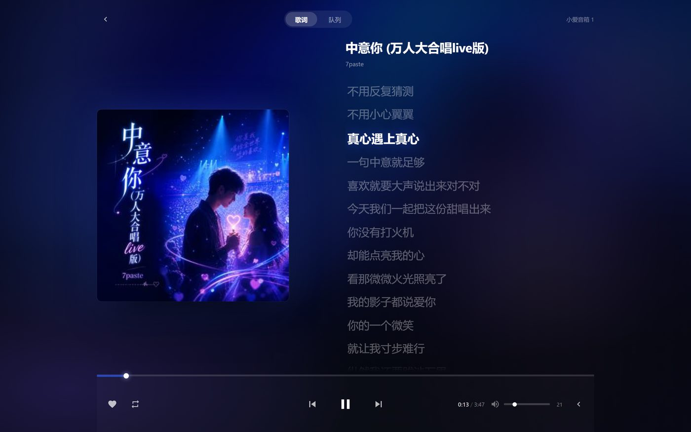

# xiaomusic-aurora

给 [xiaomusic](https://github.com/hanxi/xiaomusic)（小爱音箱音乐播放器）做的一套界面主题，外加一个补封面/歌词的刮削工具，一起打包成 Docker 镜像。

官方镜像 + 覆盖静态资源，**后端代码一行没改**，所以官方更新时改一下 `FROM` 重建即可。

浅色：



深色（跟随系统或手动切换）：



播放页：



## 它做了什么

**界面（aurora 主题）**：纯静态 HTML/CSS/原生 JS，三个文件，零依赖零构建。

- **明暗两套主题**：默认跟随系统 `prefers-color-scheme`，也可以点左栏底部按钮在「跟随系统 → 浅色 → 深色」之间切换，选择记在 localStorage
- **磨砂玻璃**：侧栏、列表、底栏都是半透明 + `backdrop-filter`，后面的底色是当前封面糊成的一片 + 几团彩色光斑，换歌会跟着变色
- 两栏：左侧设备/歌单，右侧歌曲表格 —— **行首带专辑封面缩略图**，可按标题/歌手/专辑/时长排序
- **内置设置面板**：账号 / 服务器 / 音乐库 / 口令 / 提示音 / 歌单 / 高级 / 安全 / 关于 全部在主题内，不再跳到原版 setting.html；保存走 `/savesetting`（合并式更新），也能一键刷新标签缓存
- **刮削走宿主脚本**：`/volume1/docker/xiaomusic/scrape.sh`，可以挂到群晖「任务计划」定时跑；面板「设置 → 安全」里只保留「刷新标签缓存」
- 底部常驻播放条：进度可拖、封面歌名、模式/上一首/播放/下一首/收藏、时间、音量
- **独立全屏播放页**：深色沉浸式，背景色从封面主色提取（按色相分桶取前两色），大封面 + 左对齐大字歌词，当前行高亮跟随，点歌词可跳转，队列页签可切歌
- 手机端自动塌成单列：底部播放条 + 全屏播放页，主题同样跟随系统
- 1284 首级别的库不卡首屏：标签按每批 80 条渐进加载
- 零依赖：没有 CDN、没有 npm、没有 Vue，三个文件丢进去就能跑

**刮削（scrape.py）**：给音频文件补内嵌封面和歌词。xiaomusic 只读文件内嵌标签，不读旁挂 `.lrc` / `folder.jpg`。

- 用「文件名（歌手 - 歌名）+ 音频时长」回酷狗库精确比对，再取 QQ 音乐封面、酷狗带时间轴的 LRC
- 已完整的文件直接跳过、不联网，所以新增音乐后重跑很快
- 写入走「复制到临时文件 → 写标签 → 重新打开校验 → 原子替换」，失败不动原文件

## 快速开始

```yaml
services:
  xiaomusic:
    image: zhangsan51455/xiaomusic-aurora:1.3
    container_name: xiaomusic
    restart: unless-stopped
    ports:
      - "58090:8090"   # 面板
    environment:
      XIAOMUSIC_PUBLIC_PORT: 58090
    volumes:
      - /path/to/music:/app/music
      - /path/to/config:/app/conf
```

打开 `http://NAS:58090` 就是新界面。

`/` 和旧书签 `/static/default/index.html` 都会跳到主题；原版其它主题还在 `/static/tailwind/`、`/static/pure/` 等路径下，没删。

## 自己构建

```bash
git clone https://github.com/Desire5864/xiaomusic-aurora.git
cd xiaomusic-aurora
docker build -t xiaomusic-aurora:1.3 .
```

想跟官方新版走，改 `Dockerfile` 第一行的 `FROM`，或者直接 `docker build --build-arg` 前先 `docker pull hanxi/xiaomusic:latest`。

> 注意：主题必须放到 `/app/xiaomusic/static/`，**不是** `/app/static/`。后者在镜像里只是一份残留副本，真正对外服务的是前者。

## 刮削新音乐

```bash
# 1. 把歌传到 music 目录
# 2. 面板右上角点「刷新曲库」
# 3. 补封面和歌词（已完整的自动跳过）
./scrape.sh
```

`scrape.sh` 内容就是一句：

```bash
sudo /usr/local/bin/docker exec xiaomusic python /app/tools/scrape.py --auto
```

> 群晖上 root 的 PATH 里没有 docker，必须写绝对路径。

手动分步的话：

```bash
docker exec xiaomusic python /app/tools/scrape.py --scan    # 只扫描，出报告
docker exec xiaomusic python /app/tools/scrape.py --auto    # 扫描 + 写入
docker exec xiaomusic python /app/tools/scrape.py --auto --limit 5  # 先试 5 首
```

写完会自动调 `/refreshmusictag` 刷新 xiaomusic 的标签缓存，不用手动操作。

判定规则（防止配错封面）：

- 歌名相似度 ≥ 0.60 且时长差 ≤ 2 秒，或者时长差 ≤ 1 秒
- 写入前再校验歌词正文里有没有歌名关键词、长度是否 ≥ 150 字
- 匹配不可靠的直接跳过 —— 错封面比没封面更糟

## 目录

```
aurora/                  主题（index.html / app.css / app.js / favicon.svg）
launcher-redirect.html   根路径跳转页（同时顶掉 /static/default/index.html）
scrape.py                刮削脚本
scrape.sh                宿主侧一键入口
compose.yaml             示例编排
Dockerfile               构建文件
```

## 说明

- 界面基于 MIT 协议的 xiaomusic 改造，本项目同样以 MIT 发布。
- 主题里的封面、歌词来自你自己的音乐文件；刮削只是把它们写回文件标签。
- 抓下来的音乐版权不在本项目范围内。

## License

MIT
